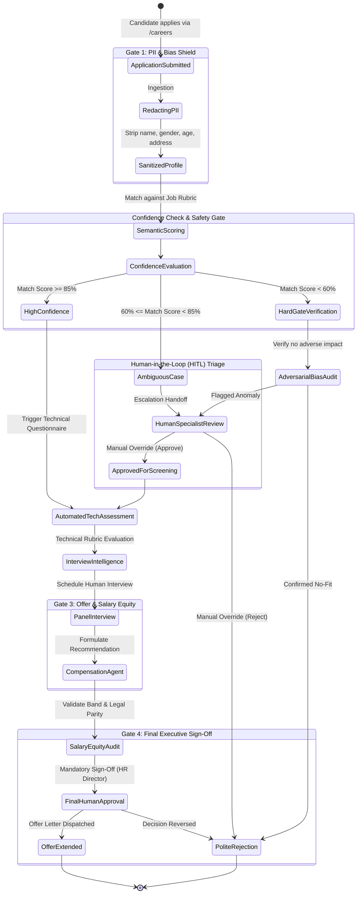
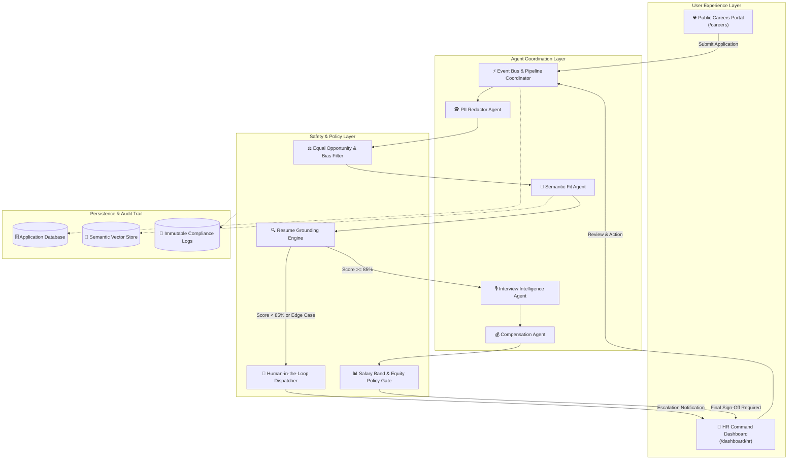

# 🤖 Agentic AI HR & Talent Intelligence Portal

[](https://nextjs.org/)
[](https://react.dev/)
[](https://www.typescriptlang.org/)
[](https://tailwindcss.com/)
[](LICENSE)

An enterprise-grade, open-source **Agentic AI Human Resources & Recruitment Platform** designed for high-velocity hiring teams. Powered by multi-agent coordination, strict safety gates, and seamless Human-in-the-Loop (HITL) governance.

---

## 🌐 Live Deployments

| Interface | URL | Description |
| :--- | :--- | :--- |
| **HR Command Center** | [hr-portal-sigma-two.vercel.app/dashboard/hr](https://hr-portal-sigma-two.vercel.app/dashboard/hr) | Internal HR dashboard for candidate evaluation, agent logs, and hiring pipelines. |
| **Candidate Careers Portal** | [hr-portal-sigma-two.vercel.app/careers](https://hr-portal-sigma-two.vercel.app/careers) | Public-facing job board and streamlined candidate application submission interface. |

---

## 🚀 Key Highlights

- **Multi-Agent Orchestration**: Specialized sub-agents for PII anonymization, semantic resume matching, automated technical screening, and offer band modeling.
- **Strict Safety Gates**: Zero unchecked AI rejections. Built-in compliance checks for EEOC/bias prevention, hallucination grounding, and salary range equity.
- **Human-in-the-Loop (HITL) Handoffs**: Configurable confidence thresholds automatically escalate ambiguous scores, edge cases, and final offer decisions to human hiring managers.
- **Modern Tech Stack**: Built on Next.js 16 App Router, React 19, TypeScript strict mode, Tailwind CSS v4, and shadcn/ui (radix-nova preset).

---

## 📊 Dynamic State-Machine & Workflow Architecture

The hiring pipeline is implemented as a deterministic finite state machine (FSM) backed by AI agents, verified through safety gates and human approval checkpoints.



---

## 🛡️ Safety Gates & Human Handoff Matrix

To guarantee fair, ethical, and explainable hiring, the platform enforces mandatory checks:

| Gate / Handoff | Target Phase | Mechanism | Action on Failure / Ambiguity |
| :--- | :--- | :--- | :--- |
| **Gate 1: PII Masking & Blind Screening** | Application Ingestion | Regex & LLM-based Named Entity Recognition (NER) strips demographic data. | Execution halts; raw resumes are quarantined until sanitization succeeds. |
| **Gate 2: Hallucination & Grounding Check** | Resume Scoring | Cross-references extracted skills with contextual project experience. | Claims lacking source citations are flagged and excluded from the match score. |
| **Handoff A: Borderline Match Escalation** | Profile Screening | Triggered when matching score falls between **60% and 84%**. | Profile dispatched to HR Review Queue (`/dashboard/hr`) with agent rationale. |
| **Gate 3: Anti-Adverse Impact Gate** | Candidate Disqualification | Evaluates distribution metrics to prevent statistical hiring bias. | Halts automatic rejections; triggers senior compliance officer review. |
| **Gate 4: Compensation Parity Gate** | Offer Formulation | Validates proposed compensation against internal leveling bands and legal equity rules. | Disallows generation of off-band or disproportionate packages. |
| **Handoff B: Mandatory Final Approval** | Offer Extension | Enforces human-signed token verification for all hire/reject actions. | AI cannot issue offers or rejections autonomously without human confirmation. |

---

## 🏗️ System Component Architecture



---

## 📁 Repository Structure

Following the co-location architecture specified in the project guidelines:

```text
src/
├── app/
│   ├── (main)/
│   │   ├── careers/                    # Public careers & application submission
│   │   │   ├── _components/            # Job board, application form widgets
│   │   │   └── page.tsx
│   │   └── dashboard/
│   │       ├── hr/                     # Main HR Agent command center
│   │       │   ├── _components/        # Candidate cards, audit tables, agent metrics
│   │       │   └── page.tsx
│   │       └── layout.tsx
├── components/
│   ├── ui/                             # shadcn/ui components (radix-nova style)
│   └── shared/                         # Cross-feature navigation & layout shell
├── hooks/                              # Custom React hooks (HITL queue, state listeners)
├── lib/                                # Utility functions, AI schemas, guardrail rules
└── styles/                             # Tailwind CSS v4 & theme presets
```

---

## 🛠️ Local Development Setup

### Prerequisites
- **Node.js**: `v20.x` or higher
- **Package Manager**: `npm`

### Installation

1. **Clone the repository**:
   ```bash
   git clone https://github.com/your-org/AgenticAI-HR.git
   cd AgenticAI-HR
   ```

2. **Install dependencies**:
   ```bash
   npm install
   ```

3. **Configure Environment Variables**:
   Create a `.env.local` file in the project root:
   ```env
   # Application Settings
   NEXT_PUBLIC_APP_URL=http://localhost:3000

   # AI Agent Configuration
   AI_MODEL_PROVIDER=openai # or anthropic / google
   AI_API_KEY=your_api_key_here

   # Safety & Guardrail Parameters
   MIN_AUTOPASS_THRESHOLD=85
   MIN_REVIEW_THRESHOLD=60
   ENABLE_PII_REDACTION=true
   ```

4. **Run the local development server**:
   ```bash
   npm run dev
   ```
   Open [http://localhost:3000/dashboard/hr](http://localhost:3000/dashboard/hr) to access the HR Dashboard or [http://localhost:3000/careers](http://localhost:3000/careers) for the public job board.

5. **Build and Validation**:
   ```bash
   npm run check    # Run Biome lint & code style checks
   npm run build    # Production Next.js build
   ```

---

## 🤝 Contributing

We welcome contributions from the open-source community!

1. Fork the Project.
2. Create your Feature Branch (`git checkout -b feat/new-safety-gate`).
3. Commit your Changes (`git commit -m 'feat: add bias mitigation rule'`).
4. Push to the Branch (`git push origin feat/new-safety-gate`).
5. Open a Pull Request.

---

## 📄 License

Distributed under the **MIT License**. See `LICENSE` for details.